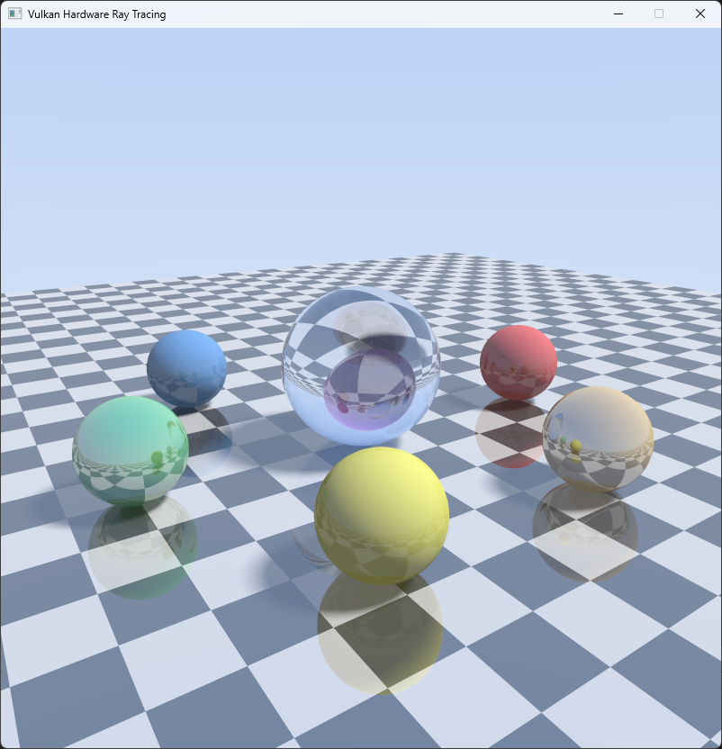

# Vulkan Hardware Ray Tracing

[](https://github.com/sponsors/makarov-mm)
[](LICENSE)

[](https://www.linkedin.com/in/makarov-mm/)
[](https://www.threads.net/@m.m.makarov)
[](https://www.instagram.com/m.m.makarov/)


A real-time, hardware-accelerated ray tracer built on the Vulkan ray tracing
pipeline (`VK_KHR_ray_tracing_pipeline`). It runs on the GPU's dedicated RT cores
using acceleration structures, a ray-gen / closest-hit / miss shader pipeline and
a shader binding table. This is genuine hardware ray tracing, not a compute-shader
software tracer.

Zero external dependencies beyond the Vulkan SDK itself: the window is created
with raw Win32 (no GLFW) and all math is inline (no GLM).



## Features

- **Hardware ray tracing with instancing** — one BLAS per mesh (a floor and a
  unit sphere) and a TLAS that places nine instances of them; materials live in
  a per-instance buffer. A full RT pipeline (ray generation, closest-hit and two
  miss shaders) and a correctly aligned shader binding table.
- **Reflections** — traced iteratively from the ray-gen shader, so
  `maxPipelineRayRecursionDepth = 1`, which every RT-capable GPU supports.
- **Temporal accumulation + anti-aliasing** — each frame casts several jittered
  samples per pixel (6 by default) and blends the result into an
  `R32G32B32A32_SFLOAT` accumulation buffer. The multi-sampling keeps motion
  smooth, and while the camera is still the image progressively refines to a
  clean, noise-free result; it resets the moment the camera moves. At 4096
  samples per pixel the image counts as converged and rendering pauses, so a
  still image costs no GPU time.
- **Soft shadows from an area light** — the scene is lit by a spherical area
  light (a visible emissive sphere). Each shading point samples the cone the light
  subtends, so the penumbra widens with the occluder's distance, like real soft
  shadows, and sharpens as the accumulation converges.
- **Glass with chromatic dispersion** — the central sphere is dielectric glass
  with Fresnel-weighted reflection and refraction (Schlick, evaluated on the air
  side so internal reflections blend smoothly into total internal reflection).
  Refraction uses a different IOR per colour channel via spectral (hero-wavelength)
  sampling, so the glass splits light into faint rainbow edges.

The scene is a reflective checkerboard floor, a central glass sphere and a ring of
six coloured spheres (some matte, some reflective), lit by a spherical area light
that is itself visible in the scene and in reflections.

## Controls

| Input            | Action                          |
|------------------|---------------------------------|
| Left mouse drag  | Orbit the camera                |
| Mouse wheel      | Zoom in / out                   |
| Esc              | Quit                            |

The window can be resized and maximised, and it stays sharp on high-DPI
displays. The title bar shows the GPU, the samples per pixel accumulated so far
and the frame time.

Hold still for a moment and watch the image converge — that is the accumulation
buffer averaging samples and cleaning up the soft-shadow and glass noise.

## Requirements

- Windows 10/11, x64.
- Visual Studio 2022 or 2026 with the C++ desktop workload. The project uses the
  v143 toolset (VS 2026 offers to retarget it) and C++23 via `/std:c++latest`.
- [Vulkan SDK](https://vulkan.lunarg.com/) 1.3 or newer (sets the `VULKAN_SDK`
  environment variable, which the project uses for include/lib paths and the
  shader compiler).
- A ray-tracing capable GPU with Vulkan 1.3 drivers:
  NVIDIA RTX 20-series or newer, AMD RX 6000-series or newer, or Intel Arc.
  On laptops the discrete GPU is preferred automatically.

## Build & run

1. Open `VulkanRayTracing.sln` in Visual Studio.
2. Select the `x64` platform (`Debug` or `Release`).
3. Build and run (F5).

The shaders are compiled to SPIR-V by a pre-build step (`compile_shaders.bat`)
and copied next to the executable; the executable finds them there regardless
of the working directory. The fast up-to-date check is disabled, so editing only
a shader and pressing F5 is enough. You can also run the batch file by hand.

Debug builds open a console with the selected GPU and, if the SDK's validation
layer is installed, Vulkan validation output. Release builds print only when
started from a terminal.

## Project layout

```
VulkanRayTracing.sln
VulkanRayTracing.vcxproj
compile_shaders.bat          shader -> SPIR-V build step
src/main.cpp                 entry point, main loop, window title
src/Window.h/.cpp            Win32 window, mouse input, DPI handling
src/VulkanContext.h/.cpp     instance, GPU selection, device, buffer/image helpers
src/Swapchain.h/.cpp         swapchain (re)creation
src/Scene.h/.cpp             meshes, instances, materials and the light
src/Renderer.h/.cpp          BLAS/TLAS, RT pipeline, SBT, per-frame trace -> blit -> present
src/Vulkan.h/.cpp            error checking and RAII handles
src/Camera.h, src/Math.h     orbit camera, minimal vector maths
shaders/shared.h             push constants, instance data, bindings (shared by C++ and GLSL)
shaders/common.glsl          ray payload
shaders/raygen.rgen          camera rays, accumulation, AA, reflections,
                             soft shadows, glass, gamma
shaders/closesthit.rchit     vertex fetch + barycentric interpolation -> surface payload
shaders/miss.rmiss           primary miss (escaped ray -> sky)
shaders/shadow.rmiss         shadow miss (point is lit)
```

## Notes

- Every Vulkan object is owned by a small RAII wrapper (`src/Vulkan.h`), so
  everything is released in the right order, also when initialisation fails.
- Two frames are in flight. The per-frame camera and light data are push
  constants, so nothing on the host has to wait for the GPU to finish reading
  them. Synchronisation uses `VK_KHR_synchronization2` (core in Vulkan 1.3) and
  is clean under the validation layer's synchronisation checks.
- Static data (vertices, indices, instance data, shader binding table) is
  uploaded once to device-local memory through a staging buffer, together with
  the acceleration-structure builds, in a single submission.
- The displayed image is an `R8G8B8A8_UNORM` storage image (matching the `rgba8`
  shader qualifier) copied to the swapchain with `vkCmdBlitImage2`, which maps
  colour components by name, so colours stay correct whether the swapchain is
  RGBA or BGRA.
- Quality / look knobs: `shaders/raygen.rgen` holds the per-channel `IOR`
  (widen the spread for stronger dispersion), the light intensity and emission,
  the ambient term and the shadow rays per hit. `kSettings` in `src/main.cpp` sets
  the samples per frame (raise it for smoother motion, lower it for more speed on
  weaker GPUs), the bounce count and the sample count at which rendering pauses.
  `src/Scene.cpp` places the objects, their materials and the light (a bigger
  radius gives softer shadows).

## License

MIT License

Copyright (c) 2026 Mykhailo Makarov

Permission is hereby granted, free of charge, to any person obtaining a copy
of this software and associated documentation files (the "Software"), to deal
in the Software without restriction, including without limitation the rights
to use, copy, modify, merge, publish, distribute, sublicense, and/or sell
copies of the Software, and to permit persons to whom the Software is
furnished to do so, subject to the following conditions:

The above copyright notice and this permission notice shall be included in all
copies or substantial portions of the Software.

THE SOFTWARE IS PROVIDED "AS IS", WITHOUT WARRANTY OF ANY KIND, EXPRESS OR
IMPLIED, INCLUDING BUT NOT LIMITED TO THE WARRANTIES OF MERCHANTABILITY,
FITNESS FOR A PARTICULAR PURPOSE AND NONINFRINGEMENT. IN NO EVENT SHALL THE
AUTHORS OR COPYRIGHT HOLDERS BE LIABLE FOR ANY CLAIM, DAMAGES OR OTHER
LIABILITY, WHETHER IN AN ACTION OF CONTRACT, TORT OR OTHERWISE, ARISING FROM,
OUT OF OR IN CONNECTION WITH THE SOFTWARE OR THE USE OR OTHER DEALINGS IN THE
SOFTWARE.

## Support

If you found this project interesting or useful, you can support my work:

[](https://github.com/sponsors/makarov-mm)
